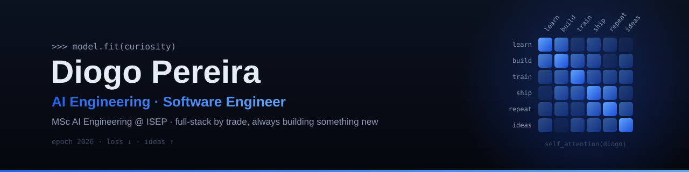

# Hi, I'm Diogo 👋

I'm a full-stack software engineer currently going all-in on **Artificial Intelligence** — studying it, building with it, and figuring out where it actually makes a difference. There's always a new project on my mind, and most of them end up with code.

> 🇵🇹 Prefere português? [Salta para a versão em português ↓](#pt)

## 🧠 What I'm into right now

| | |
| :--- | :--- |
| 🎓 **Studying** | Master's in **Artificial Intelligence Engineering** at ISEP — Instituto Superior de Engenharia do Porto |
| 💼 **Working** | Software Engineer at **MC**, in the People Stream team |
| 🤖 **Building** | [**Syntraq**](https://github.com/DiogoMMP/syntraq) — a Claude Code plugin marketplace with skills that take an agent from request to delivery |
| 💰 **Shipped** | [**Poupa-me**](https://github.com/DiogoMMP/poupa-me) — a personal finance app with AI-powered transaction categorisation (Angular + Node.js/TypeScript + PostgreSQL) |
| 📸 **On the side** | Social Media Manager and Web Developer at [@hugosilvaphotography](https://www.instagram.com/hugosilvaphotography/) |
| 🏁 **Background** | BSc in Computer Engineering from ISEP |

## 🧰 Toolbox

| Area | Stack |
| :--- | :--- |
| **Languages** |     |
| **Backend** |   |
| **Frontend** |      |
| **Databases** |   |
| **Tools** |  |

## 🏅 Certifications

## 📈 Activity

  
  

<picture>
  <source media="(prefers-color-scheme: dark)" srcset="https://raw.githubusercontent.com/DiogoMMP/DiogoMMP/output/github-contribution-grid-snake-dark.svg">
  <source media="(prefers-color-scheme: light)" srcset="https://raw.githubusercontent.com/DiogoMMP/DiogoMMP/output/github-contribution-grid-snake.svg">
  
</picture>

## 📬 Let's talk

 

---

<b>🇵🇹 Versão em português</b>

Sou engenheiro de software full-stack e, neste momento, estou focado a fundo em **Inteligência Artificial** — a estudá-la, a construir com ela e a perceber onde é que realmente faz a diferença. Tenho sempre um projeto novo em mente, e a maioria acaba em código.

| | |
| :--- | :--- |
| 🎓 **A estudar** | Mestrado em **Engenharia de Inteligência Artificial** no ISEP — Instituto Superior de Engenharia do Porto |
| 💼 **A trabalhar** | Software Engineer na **MC**, na equipa de People Stream |
| 🤖 **A construir** | [**Syntraq**](https://github.com/DiogoMMP/syntraq) — marketplace de plugins para o Claude Code, com skills que levam o agente do pedido à entrega |
| 💰 **Entregue** | [**Poupa-me**](https://github.com/DiogoMMP/poupa-me) — aplicação de finanças pessoais com categorização de transações por IA (Angular + Node.js/TypeScript + PostgreSQL) |
| 📸 **Em paralelo** | Social Media Manager e Web Developer na [@hugosilvaphotography](https://www.instagram.com/hugosilvaphotography/) |
| 🏁 **Formação** | Licenciatura em Engenharia Informática pelo ISEP |

